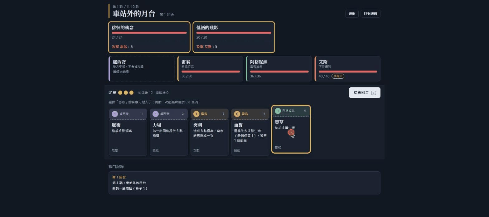

# 餘燼車站

一款在瀏覽器裡玩的卡牌 Roguelite。三位同伴共用一副牌組，後方的盧西安用「增幅」讓隊友的下一張牌加倍，撐過車站裡的十場戰鬥。

React + TypeScript + Vite 製作，是一份前端作品集：重點在**遊戲邏輯與 UI 分離、可重現的隨機、型別安全的資料驅動設計、自動化測試與平衡模擬**。

**線上試玩**：（部署後填入 Vercel 網址）



---

## 怎麼玩

- 每回合 3 點能量、抽 5 張牌。點一張牌，再點目標打出；不需要目標的牌點了就會打出。
- **盧西安**沒有血條，負責支援：「增幅」讓下一張牌效果加倍，「解析」讓敵人本回合受到的傷害 +50%。
- **雷翁**生命在一半以下時進入「背水」，方陣與突刺變強。
- **阿格妮絲**的中毒在敵人行動前造成傷害。
- **艾斯**的下注牌賭成功率；失敗累積「手氣」，「袖裡藏牌」讓下一次必定成功。
- 同伴倒下後，他們的牌本場無法使用；戰鬥結束後以 30% 生命復活。三人全倒就失敗。
- 每場勝利後挑一張新牌、可以移除一張牌，再休息回復。第 10 場是 Boss。

鍵盤：`1`–`9`、`0` 選第 1–10 張手牌，`Esc` 取消，`E` 結束回合。進度會自動存在瀏覽器裡，可以從標題畫面繼續。

---

## 執行

需要 Node.js 22.18 以上（模擬器與檢查腳本直接用 Node 執行 TypeScript，不需要額外工具）。

```bash
npm install
```

```bash
npm run dev
```

| 指令 | 用途 |
| --- | --- |
| `npm run dev` | 開發伺服器。網址加 `?seed=123` 可以指定這一輪的種子 |
| `npm test` | 執行全部測試（Vitest） |
| `npm run typecheck` | TypeScript 嚴格模式型別檢查 |
| `npm run lint` | ESLint，同時檢查引擎沒有依賴 React、沒有用 `Math.random` |
| `npm run sim -- --runs 1000 --seed 1` | 平衡模擬器：用機器人玩上千局，輸出各關通過率 |
| `npm run build` | 型別檢查後正式建置到 `dist/` |
| `npm run size` | 檢查建置後的 JavaScript 經 gzip 是否小於 200KB |
| `npm run check` | 一次跑完 lint、測試、建置與套件大小檢查 |

---

## 架構

```
src/
  engine/   純 TypeScript 的規則引擎（不能 import React，不能用 Math.random 或讀取時間）
  data/     卡牌、角色、關卡、起始牌組：所有數值都在這裡
  sim/      平衡模擬器與貪婪機器人（在 Node 執行）
  ui/       React 介面，只透過引擎的公開函式與事件跟遊戲互動
tests/      Vitest 測試
scripts/    建置後的檢查腳本
```

```
          ┌────────────── 動作（NEW_RUN、PLAY_CARD、END_TURN…）
          │
  UI ─────┼──▶ reduce(state, action) ──▶ { state, events, frames? }
  模擬器 ──┘          │                         │
                     │ 讀 data/ 的數值          ├─ events：戰鬥紀錄、浮動數字
                     │ 用 state 裡的亂數狀態     └─ frames：敵人依序行動的動畫
```

### 設計重點

- **純函式 reducer**：`reduce(state, action)` 先複製一份草稿，所有規則都在草稿上運算，回傳新狀態與事件，從不修改傳入的狀態。測試會把輸入深度凍結來驗證這一點。
- **可重現的隨機**：亂數用 mulberry32，亂數狀態本身就存在 `GameState` 裡。同一個種子加上同一串動作，必定得到完全相同的結果。存檔、重播與模擬器都依賴這個性質。
- **事件驅動的 UI**：引擎回傳事件（`damage`、`block`、`bet`、`allyDown`…），戰鬥紀錄與浮動數字都由事件產生，UI 不需要自己比對前後狀態。
- **影格**：`reduce(state, action, { frames: true })` 會另外回傳每個敵人行動後的狀態快照，UI 依序播放，就能做出「敵人一個一個反擊、間隔 400 毫秒」的節奏，而不用在 UI 裡重寫任何規則。模擬器不開這個選項，所以沒有額外成本。
- **資料驅動的卡牌**：每張卡的數字都放在 `values`，`play` 與 `describe` 都從這裡讀。改數值只要改資料，卡面文字也永遠與實際效果一致。
- **嚴格型別**：開啟 `strict`，卡牌與角色 id 是字串聯合型別，`Record<CardId, CardDef>` 讓漏寫任何一張卡都無法通過編譯。
- **邊界由工具把關**：ESLint 禁止 `src/engine` 與 `src/data` import React、使用 `window`、`Math.random`、`Date.now`。

---

## 測試

12 個測試檔、265 個測試，涵蓋：

- **每張卡**：被增幅與未被增幅的結果（`tests/cards.test.ts`）
- **每個機制**：增幅、解析、背水、中毒、餘毒、下注、出千、灌鉛骰子、反擊、倒下、休息復活（`tests/mechanics.test.ts`）
- **規則**：傷害與格擋順序、抽牌與洗牌、手牌上限、敵人意圖與目標權重、一輪的完整流程
- **重現性與純函式**：同種子同動作得到相同狀態；reducer 不修改輸入
- **規格對照清單**：規格書第 11 節的六個情境（`tests/checklist.test.ts`）
- **模擬器、UI 邏輯、存檔、影格與動畫時序**：UI 的狀態機與畫面資料都寫成純函式，不需要 DOM 就能測

---

## 平衡模擬

```bash
npm run sim -- --runs 1000 --seed 1
```

模擬器用一個簡單的貪婪機器人玩完整的一輪：優先打出能擊殺的攻擊 → 同伴快被打穿時出格擋或回復 → 其餘攻擊依費用高到低。獎勵一律選第一張，移除一律移除脈衝或力場。

1000 局約 1 秒跑完，同一個種子的輸出完全相同（報告寫在 stdout、耗時寫在 stderr，可以直接 `diff`）。

| 版本 | 貪婪機器人整體勝率 | 備註 |
| --- | --- | --- |
| 原始數值 | 2.7% | 第 9 場「無盡的軌道」通過率只有 35%、Boss 16% |
| 第 7–10 場敵人攻擊 −3 | **38.2%** | 落在設計目標 20%–60% 內 |

調整前先用敏感度實驗比較了十幾種方案，發現瓶頸是同伴承受的傷害而不是敵人血量：降低後期敵人生命 15% 只能拉到 8.5%，降低攻擊 3 點則到 38%。

---

## 部署

部署在 Vercel：連接這個 GitHub repo 後，每次推送到 `main` 都會自動建置並上線。`vercel.json` 指定建置指令為 `npm run build && npm run size`，所以型別錯誤或套件超過 200KB 都會讓部署失敗，不會上線。

GitHub Actions（`.github/workflows/ci.yml`）在每次推送與 PR 時另外執行 lint、測試、建置、套件大小檢查與一次短模擬。

建置使用相對路徑（`base: './'`），放在任何子路徑下都能運作。

---

## 技術選擇

- 執行時只依賴 React；狀態管理用 `useReducer`，樣式是純 CSS，沒有其他套件。
- 沒有圖片與外部字型：角色以代表色區分（盧西安紫、雷翁銅、阿格妮絲綠、艾斯紅），卡牌做成車票的樣子。
- 支援深淺色模式（跟隨系統設定）、手機直向 375px 與橫向、鍵盤操作，並尊重「減少動態效果」設定。
- 正式建置的 JavaScript 經 gzip 後約 82KB。
